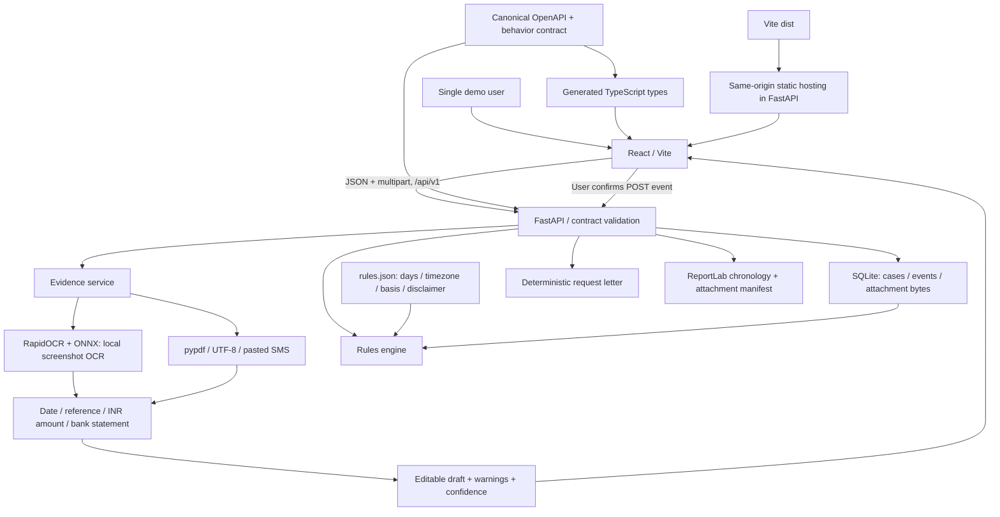
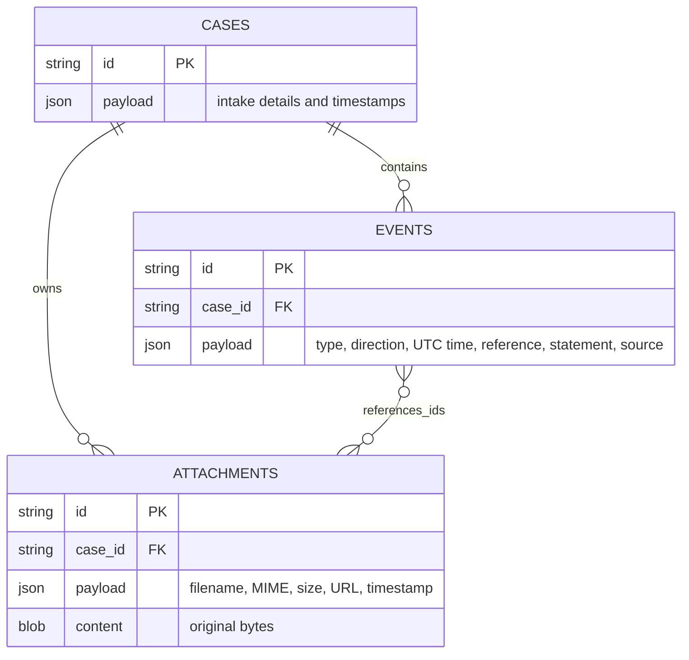

# Architecture

## Data model

SQLite foreign keys cascade demo reset. Event attachment ownership is enforced by the API; event attachment IDs live in the JSON payload. Attachment bytes are stored in SQLite so one database backup covers the records and original evidence. Use SQLite's backup API for a consistent live backup; copying only the main file while WAL writes are active can lose recent transactions.

Status and case summaries derive from the ordered event log on each request. Resolution wins, followed by first-contact detection, then the configured deadline. PDF and frontend use this same server computation. No timer job, browser deadline arithmetic or background AI service is needed.

OCR runs in a worker thread with a cached model. The first screenshot may take longer while ONNX initializes. Parsing failures do not create events. Draft attachments can remain unreferenced, as the contract permits. PDF export escapes user strings before passing them to ReportLab markup.

## Feasibility and tradeoffs

The demo runs on one CPU host, offline after dependency installation, with no paid inference API. SQLite avoids an external database deployment and is suitable for this single-user scope. Local OCR protects message privacy and makes the key feature reproducible; text extraction still needs human review. ReportLab provides a useful downloadable record even when escalation is not yet ready.

For a multi-user service, introduce identity and ownership at every endpoint, normalized relational event/attachment links, migrations, private object storage with signed downloads, task queues and resource budgets for OCR, observability and a legally maintained rules policy. The present rules are intentionally scoped to the supplied prototype contract.
